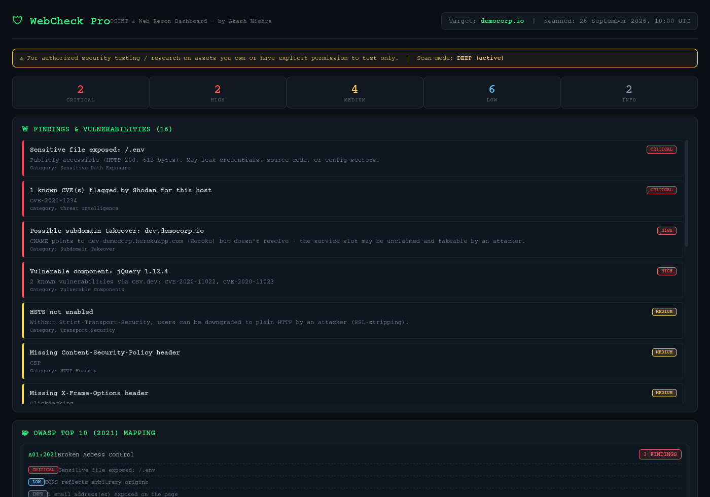
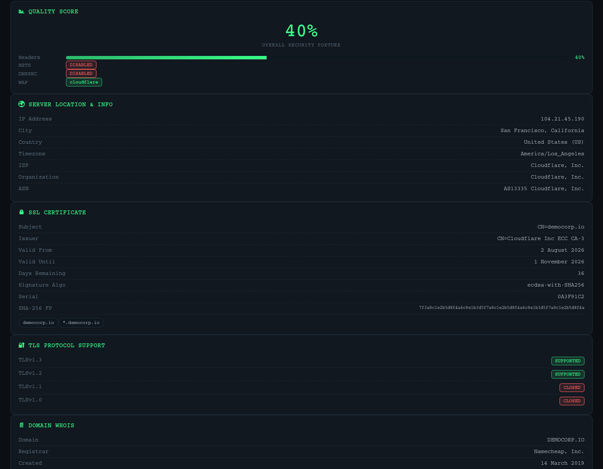
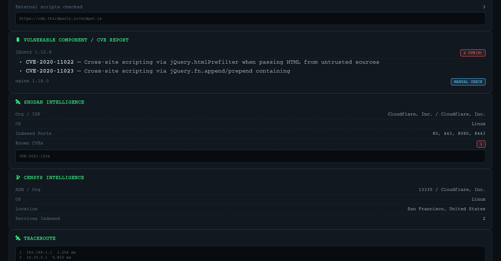

<div align="center">



# 🛡️ WebCheck Pro

**An all-in-one OSINT & Web Security Recon Dashboard, built for Kali Linux**

[](LICENSE)
[](https://www.python.org/)
[](#-installation-kali--debian-linux)
[](../../actions)
[](#-contributing)
[](#-author)

25+ recon & active security checks • parallel scan engine • severity-ranked findings •
OWASP Top 10 mapping • CVE lookups • Shodan/Censys enrichment • one self-contained HTML dashboard

</div>

---

## 📚 Table of Contents

- [Why WebCheck Pro](#-why-webcheck-pro)
- [Screenshots](#-screenshots)
- [Features](#-features--checks-performed)
- [Installation](#-installation-kali--debian-linux)
- [Usage](#-usage)
- [Accuracy & Limitations](#-accuracy--limitations)
- [Project Structure](#️-project-structure)
- [Extending It](#-extending-it)
- [Contributing](#-contributing)
- [Legal / Ethical Use](#️-legal--ethical-use)
- [Author](#-author)

---

## 🚀 Why WebCheck Pro

Point it at a domain and get back a single dark-themed HTML dashboard covering
DNS, SSL/TLS, WHOIS, headers, WAF/tech fingerprinting, subdomains, open ports,
CORS/clickjacking/open-redirect probes, sensitive-file exposure, CVE lookups
against fingerprinted library versions, optional Shodan/Censys enrichment, an
optional headless-Chromium screenshot, and a severity-ranked **Findings &
Vulnerabilities** panel mapped straight onto the **OWASP Top 10 (2021)**.

Everything runs concurrently through a thread pool, every check is
crash-isolated (one failed lookup never kills the scan), and the whole thing
is a dependency-light Python CLI you fully own and can extend.

## 📸 Screenshots

<div align="center">
<br>
<sub>Severity-ranked findings + OWASP Top 10 (2021) mapping</sub>
<br><br>
<br>
<sub>Server location, SSL certificate, TLS protocol support &amp; WHOIS</sub>
<br><br>
<br>
<sub>CVE / vulnerable-component report + Shodan &amp; Censys enrichment</sub>
</div>

## ✨ Features / Checks Performed

| Category | Details |
|---|---|
| 🌍 Server Location & Info | IP resolution, GeoIP (city/country/timezone), ISP, Org, ASN |
| 🔒 SSL Certificate | Subject, issuer, validity window, days-until-expiry, SHA-256 fingerprint, SANs |
| 🔐 TLS Protocol Support | Probes TLSv1.0 / 1.1 / 1.2 / 1.3 support (flags legacy protocols) |
| 📄 WHOIS | Registrar, creation/updated/expiry dates, org, name servers |
| 🗂️ DNS Records | A, AAAA, CNAME, MX, NS, TXT, SOA |
| 🔑 DNSSEC | Enabled/disabled + key count |
| 🛡️ HSTS | max-age, includeSubDomains, preload status |
| 🧱 Security Headers | CSP, X-Frame-Options, X-Content-Type-Options, Referrer-Policy, Permissions-Policy, etc. |
| 🧯 WAF / Firewall Detection | Cloudflare, Sucuri, Akamai, Imperva, AWS WAF, F5, Fastly signatures |
| ⚙️ Tech Stack Fingerprinting | React, Vue, Angular, WordPress, jQuery, GTM, GA, Stripe, etc. |
| 🍪 Cookies | Name, Secure / HttpOnly flags |
| 📡 HTTP Response | Status code, redirects, response time, full raw headers |
| 🌐 Subdomain Enumeration | via crt.sh Certificate Transparency logs |
| 🔓 Port Scan | Fast threaded scan of 19 common service ports |
| 🤖 robots.txt / 📝 security.txt | Presence + content |
| 🛰️ Traceroute | Full hop-by-hop path to the target |
| 🔀 CORS Policy | Detects reflected-origin + credentials misconfiguration |
| 🔧 HTTP Methods | OPTIONS enumeration, flags risky verbs (PUT/DELETE/TRACE) |
| 🖼️ Clickjacking | X-Frame-Options / CSP frame-ancestors protection check |
| 🎯 Subdomain Takeover | CNAME-vs-resolution heuristic against 12 known services |
| 📡 Zone Transfer (deep) | Attempts AXFR against every authoritative nameserver |
| ↪️ Open Redirect (deep) | Non-destructive probe of common redirect parameters |
| 🏷️ Banner Grabbing (deep) | Grabs service banners from every open port |
| 🧱 Subdomain Bruteforce (deep) | 50-word built-in wordlist, multi-threaded |
| 📧 Email Harvesting | Extracts exposed email addresses from the page |
| 🗝️ Sensitive File Exposure | Checks for `.env`, `.git/config`, backups, etc. |
| 🧷 Subresource Integrity | Flags cross-origin scripts missing SRI hashes |
| 🐛 CVE / Vulnerable Components | Version fingerprinting + OSV.dev lookups |
| 🛰️ Shodan Intelligence | Optional — indexed services, banners, known CVEs |
| 🔭 Censys Intelligence | Optional — ASN, OS, location, indexed services |
| 📸 Screenshot | Optional — headless-Chromium visual capture |
| 🧩 OWASP Top 10 Mapping | Every finding categorized under A01–A10 |
| 🚨 **Findings Report** | Auto-generated, severity-ranked vulnerability summary |
| 📊 Quality Score | Weighted composite score (headers + HSTS + SSL + WAF + DNSSEC) |

## 📦 Installation (Kali / Debian Linux)

```bash
git clone https://github.com/akku2525/webcheck-pro.git
cd webcheck-pro
chmod +x install.sh
./install.sh
```

(No GitHub repo yet? Just unzip the downloaded folder and `cd` into it instead of `git clone`.)

This installs the Python dependencies and the `traceroute` package if missing.

## 🚀 Usage

```bash
# Fast scan (default) — saves HTML dashboard to reports/<domain>_report.html
python3 webcheck.py -u example.com

# Deep/active scan — adds subdomain bruteforce, zone-transfer test,
# open-redirect probing, and banner grabbing
python3 webcheck.py -u example.com --deep

# Custom output path, more threads, save raw JSON, auto-open in browser
python3 webcheck.py -u https://example.com -o /tmp/report.html \
    --deep --threads 40 --json results.json --open

# With screenshot + Shodan + Censys enrichment
python3 webcheck.py -u example.com --deep --screenshot \
    --shodan-key YOUR_SHODAN_KEY \
    --censys-id YOUR_CENSYS_ID --censys-secret YOUR_CENSYS_SECRET

# Or set API keys as environment variables instead of flags
export SHODAN_API_KEY="your_key_here"
export CENSYS_API_ID="your_id_here"
export CENSYS_API_SECRET="your_secret_here"
python3 webcheck.py -u example.com --deep --screenshot
```

<details>
<summary><b>Full CLI reference</b></summary>

| Flag | Description |
|---|---|
| `-u`, `--url` | Target domain or URL (required) |
| `-o`, `--output` | Output HTML report path (default: `reports/<domain>_report.html`) |
| `--json PATH` | Also save raw scan results as JSON |
| `--open` | Open the report in your default browser when done |
| `--deep` | Enable active mode: subdomain bruteforce, zone-transfer test, open-redirect probing, banner grabbing, full sensitive-path list |
| `--threads N` | Max concurrent worker threads (default: 20) |
| `--screenshot` | Capture and embed a headless-Chromium screenshot |
| `--shodan-key KEY` | Shodan API key (or `SHODAN_API_KEY` env var) |
| `--censys-id ID` / `--censys-secret SECRET` | Censys API credentials (or `CENSYS_API_ID` / `CENSYS_API_SECRET` env vars) |
| `--no-banner` | Suppress the ASCII banner |

</details>

### Getting API keys (optional, free tiers available)
- **Shodan**: https://account.shodan.io/ (free tier gives limited host lookups/month)
- **Censys**: https://search.censys.io/account/api (free tier available)

Both are entirely optional — the tool works fully without them, it just
skips that enrichment step and says so in the report.

### Screenshot requirements

The screenshot module shells out to a headless Chromium/Chrome binary
already on your system. If none is found, install one:
```bash
sudo apt install chromium        # Kali/Debian
# or
sudo apt install chromium-browser
```

### Optional: install as a system command

```bash
sudo ln -sf $(pwd)/webcheck.py /usr/local/bin/webcheck
webcheck -u example.com
```

## 🎯 Accuracy & Limitations

Being upfront about what's rock-solid vs. what's a best-effort heuristic:

| Confidence | Checks | Why |
|---|---|---|
| **High (deterministic)** | DNS records, WHOIS, SSL certificate details, HTTP headers/status, HSTS, TLS protocol support, robots.txt/security.txt, port scan, CVE lookups (OSV.dev) | Direct protocol-level queries or a real database lookup — the same data `dig`, `openssl s_client`, or `curl -I` would show you. |
| **Good (signature-based)** | WAF/CDN detection, tech-stack fingerprinting, CVE version fingerprinting | Matches known header/HTML patterns. Can miss custom setups or give false negatives if a site strips identifying headers — rarely false *positives*. |
| **Best-effort (heuristic)** | Subdomain takeover, open-redirect probing, CORS/clickjacking checks | Solid indicators, not proof. A "suspicious" takeover flag or open-redirect hit should always be manually verified before reporting it as a real vulnerability. |
| **Environment-dependent** | Traceroute, port scan, banner grabbing | Accuracy depends on firewalls/ICMP filtering between *your* machine and the target, and whether the target sits behind a CDN (Cloudflare etc.) that fronts the real origin IP — you may be scanning the CDN edge, not the backend server. |
| **Third-party dependent** | Shodan, Censys, crt.sh subdomains, geolocation | As fresh/accurate as those services' own indexes, which lag real-world state by anywhere from hours to weeks. |

**Bottom line:** treat the Findings panel as a prioritized starting point for
manual verification, not a certified pentest report. That's true of every
automated scanner (Nessus, Nikto, ZAP included) — automated recon narrows
down where to look; a human still confirms exploitability.

## 🗂️ Project Structure

```
webcheck-pro/
├── webcheck.py                  # CLI entry point
├── modules/
│   ├── scanner.py               # Core recon + active-check functions
│   ├── findings.py              # Severity-ranked findings engine
│   ├── owasp.py                 # OWASP Top 10 (2021) mapping
│   ├── cve.py                   # Version fingerprinting + OSV.dev CVE lookups
│   ├── threat_intel.py          # Shodan / Censys integration
│   └── screenshot.py            # Headless-Chromium screenshot capture
├── templates/
│   └── report_template.html     # Dark-themed dashboard template (Jinja2)
├── assets/                      # README screenshots
├── .github/workflows/ci.yml     # Compile-check CI on every push
├── install.sh                   # One-shot installer for Kali/Debian
├── requirements.txt
├── LICENSE
└── reports/                     # Generated HTML dashboards land here (gitignored)
```

## 🧩 Extending It

Every check in `modules/scanner.py` is a small, independent function wrapped
with the `@safe` decorator — a failure in one check never breaks the rest of
the scan. To add a new check:

1. Write a function in `scanner.py` (or a new module), decorate it with `@safe`.
2. Call it inside `run_full_scan()` and store the result in `data[...]`.
3. Add a matching `<div class="card">` block in `templates/report_template.html`.
4. If it's a real vulnerability signal, add a rule for it in `modules/findings.py`
   and (optionally) map its category to an OWASP bucket in `modules/owasp.py`.

Ideas for extending further: breach-database lookups (HaveIBeenPwned API),
Wappalyzer-grade tech fingerprinting, PDF export, a scan-history/diff view,
or a REST API wrapper around `run_full_scan()`.

## 🤝 Contributing

Issues and PRs are welcome — whether it's a new check, a bug fix, or a
README typo.

1. Fork the repo and create a branch: `git checkout -b feature/my-check`
2. Make your change (see [Extending It](#-extending-it) above)
3. Run `python -m py_compile webcheck.py modules/*.py` before committing
4. Open a PR describing what it adds and why

## ⚖️ Legal / Ethical Use

WebCheck Pro only performs **passive/OSINT-style reconnaissance and
lightweight active checks** (HTTP requests, DNS lookups, a TCP port scan,
and a traceroute) against a target you provide. Only run it against:

- Domains/systems **you own**, or
- Targets you have **explicit written authorization** to test.

Unauthorized scanning of systems you do not own or have permission to test
may be illegal in your jurisdiction. You are responsible for how you use
this tool.

## 👤 Author

**Akash Mishra**

If this tool is useful to you, consider ⭐ starring the repo — it helps
other security folks find it.

---
<div align="center">Built with ❤️ and a lot of ☕ by <b>Akash Mishra</b></div>
